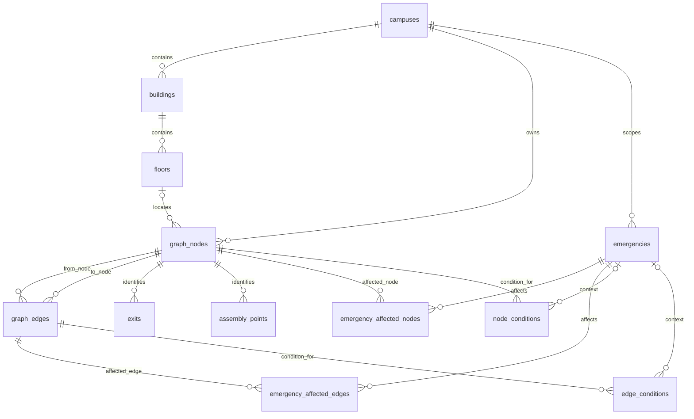

# Sentinel EvacOS Database Schema

> **Phase: 2 — Database Schema and Campus Graph Foundation**
> **Provider: Supabase PostgreSQL**

## Architecture

The database stores a campus as a graph, $G = (V, E)$, where `graph_nodes` are vertices and `graph_edges` are connections. The schema supports multiple campuses; no campus is encoded as a special case.

Static physical topology is stored separately from temporary operational state. Emergency activity and condition records never overwrite a node's or edge's base capacity, speed, location, or type.



## Tables

| Table | Purpose |
|---|---|
| `campuses` | Independent campus records, including optional description, address, and coordinates. |
| `buildings` | Buildings belonging to a campus; building codes are unique within that campus. |
| `floors` | Floors belonging to a building; signed `floor_number` supports basements and ground floors. |
| `graph_nodes` | Navigational points on a floor or outdoors; node type is constrained to the supported vocabulary. |
| `graph_edges` | Static connections with positive distance, base capacity/speed, edge type, and one-way/bidirectional directionality. |
| `exits` | Active or inactive exit records attached to same-campus graph nodes. |
| `assembly_points` | Assembly locations attached to same-campus graph nodes. |
| `emergencies` | Campus-scoped emergency records with constrained type, severity, status, and timestamps. |
| `emergency_affected_nodes` | Per-emergency node risk, blockage, and reason. |
| `emergency_affected_edges` | Per-emergency edge risk, blockage, and reason. |
| `node_conditions` | Current (null emergency) or emergency-specific node observations. |
| `edge_conditions` | Current or emergency-specific edge observations, including effective speed. |

Node and edge types, emergency types, severity, status, and exit types use `CHECK` constraints rather than PostgreSQL enums. This keeps values controlled while allowing a future migration to expand the supported vocabulary without enum lifecycle constraints.

## Integrity and Performance

- UUID primary keys use PostgreSQL `gen_random_uuid()` defaults.
- Composite campus-scoped foreign keys ensure floors, nodes, edges, exits, assemblies, and emergency effects cannot cross campus boundaries.
- Graph edges cannot connect a node to itself. Distances, capacities, speeds, coordinates, risk values, and condition counts have range checks.
- JSON metadata is constrained to JSON objects.
- Foreign-key lookup indexes cover campus/building/floor/node/edge relationships, emergency status, and condition lookups.
- Partial unique indexes allow one current condition per node/edge and one condition per emergency and node/edge.
- `updated_at` is maintained by a database trigger on mutable entity and condition tables.
- Foreign keys use restrictive default delete behavior; deleting topology referenced by other records requires an intentional cleanup.

## Security

RLS is enabled on all 12 application tables. No anon/authenticated policies are created: direct client access is denied by default. The application continues to use `Next.js → FastAPI → PostgreSQL`; database credentials remain backend-only. The backend connection uses the configured server-side PostgreSQL URL, and no Supabase secret is included in frontend code.

When authenticated direct Supabase access is designed in a later phase, add explicit least-privilege policies and test them. Do not add unrestricted policies to make the current backend work.

## Migration and Demo Data

The schema migration is `supabase/migrations/202610090001_initial_campus_schema.sql`. It runs transactionally and uses idempotent DDL (`IF NOT EXISTS`, replaceable trigger function, recreated timestamp triggers). Demo data lives separately in `supabase/seed.sql`, uses stable synthetic UUIDs, and inserts with `ON CONFLICT DO NOTHING` so it can be rerun without overwriting edited demo records.

With the Supabase CLI installed and the project linked:

```powershell
supabase link --project-ref <project-ref>
supabase db push
```

Apply the demo seed separately to the linked database using the Supabase SQL Editor, or use `psql` with the backend-only `SUPABASE_DB_URL`:

```powershell
psql "$env:SUPABASE_DB_URL" -v ON_ERROR_STOP=1 -f supabase/seed.sql
```

For a local Supabase stack, `supabase db reset` applies migrations and, with the checked-in `supabase/config.toml`, the configured seed file. The backend's existing test suite includes live catalog/constraint checks when `SUPABASE_DB_URL` is configured; those database integration checks skip when it is absent.

## Synthetic Demo Campus

`Demo Campus` contains two synthetic buildings (Administration and Academic), ground and first floors for both, 21 navigational nodes, 20 static connections, three exits, and one assembly point. It includes rooms, corridors, junctions, staircases, entrances, outdoor connections, bidirectional edges, and one-way edges. Coordinates and distances are illustrative local-map values, not real-world campus data. The seed creates no emergencies or live condition records.

## Scope Boundary

This schema does not implement pathfinding, route calculation, emergency response behavior, crowd prediction, AI/ML, authentication, or realtime features. Static graph data and dynamic condition data are only persisted as a foundation for later phases.